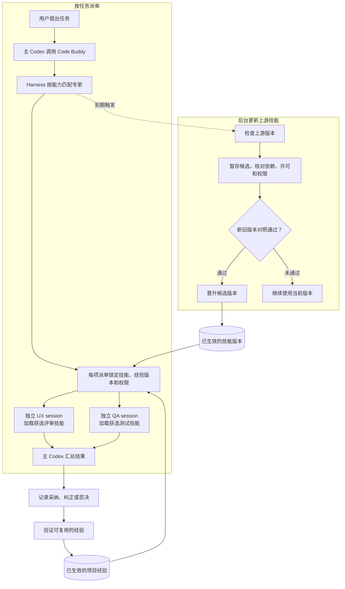

# Code Buddy 专家技能的按需加载与自动更新

设计记录 · 2026-11-17 · agent runtime / skill lifecycle

Codex 源码基线 `b78fa4af8636859f4acc4d57420e41e923c84cdd`

## 结论

主 Codex 只需要一个 Code Buddy 派单入口。harness 根据任务选专家和技能版本，
把匹配的技能包与项目经验交给本次专家 session。上游有更新时，harness 先把新版本
作为候选跑对照，达到质量和权限要求后再切换。正在执行的任务固定使用派单时选定的版本。

当前原型用 skill 提示主会话调用 Python harness，再由主会话启动子 agent。这里
设计的运行时入口负责执行和记账，覆盖通过它提交的任务。普通 Codex turn 的自动接入
需要单独的宿主集成。前次实验中，两项经验生成了候选角色，CSV 对照没有发现候选相对
普通 UX 的额外实质贡献。职业技能可以提供更强的初始方法，其效果仍由对照验证。

## 运行示意



候选晋升后的新任务使用新版。进行中的任务和原派单 ID 的重试继续读取各自锁定的版本。

## 一次派单

假设主会话收到「评审 CSV 导入页面的可达性，再看失败时怎么恢复」。

1. **拆任务。** 主会话把评审目标、项目标识和可访问材料交给 `buddy run`。
   harness 按任务能力匹配技能目录中的元数据。`accessibility-review` 命中 UI
   评审，`failure-recovery` 命中已有的项目经验。路由记录所选能力、为何命中和
   使用的来源版本。置信度不足时用普通评审，并记录按什么线索走了 fallback。
2. **锁定输入。** harness 为每个任务生成独立的派单记录，锁定专家版本、技能包
   摘要、项目经验版本、材料引用和工具权限。一个专家的多个任务各自启动 session，
   共享相同的只读版本快照。运行中的 session 根据其快照复现。
3. **加载与执行。** harness 先为专家准备仅含获选技能的只读目录，再启动独立的
   Codex app-server worker。用 `skills/list` 确认选中版本的路径可用，随后在该
   worker 的 `turn/start` 中按路径明确传入技能。专家同时收到当前问题、材料和项目经验。
   主会话只接收派单摘要、进度和专家的交付结果。
4. **回写。** harness 订阅 worker 生命周期事件，把实际启动的 thread、技能版本、
   结束状态和发现关联到派单记录。用户采纳、纠正或否决发现后，再记录决定及证据。
   同一个派单 ID 的重试续用原版本。尚未完成的任务保留可排查的状态，已落库结果按
   派单及发现 ID 去重。worker 退出后释放并发名额，宿主对未退出的进程设定清理时限。

主会话和 worker 之间的最小合同如下。字段值是示意。

```text
dispatch: task_id, project_id, capability, worker_id, state
pin:      role_version, skill_source, upstream_commit, bundle_sha256, experience_version
input:    brief, artifact_refs, tool_policy
result:   thread_id, status, findings[], elapsed_ms
feedback: finding_id, verdict, decision, evidence_ref
```

技能目录只用简短描述和适用能力做匹配。获选后才读取 `SKILL.md` 和它引用的局部
资源。这与 Agent Skills 规范的渐进加载一致。
[Agent Skills 规范](https://agentskills.io/specification)

### Codex 集成选择

- **原生路径。** `turn/start` 支持 `{type: "skill", name, path}`，路径必须匹配
  已发现且启用的 skill。`skills/extraRoots/set` 修改的是该 app-server 的共享
  服务状态，所以每个 worker 进程拥有自己的固定根目录。运行中的共享进程里反复切换
  根目录会让并行任务争用同一状态。MVP 为每个执行分配独立 worker，后续可按相同
  技能集合与权限复用空闲进程。[输入协议](https://github.com/openai/codex/blob/b78fa4af8636859f4acc4d57420e41e923c84cdd/codex-rs/app-server-protocol/src/protocol/v2/turn.rs#L481) · [技能选择](https://github.com/openai/codex/blob/b78fa4af8636859f4acc4d57420e41e923c84cdd/codex-rs/skills/src/selection.rs#L63) · [根目录作用域](https://github.com/openai/codex/blob/b78fa4af8636859f4acc4d57420e41e923c84cdd/codex-rs/app-server/src/request_processors/catalog_processor.rs#L632)
- **原型过渡。** 当前 skill 可以先把锁定的本地技能正文或路径交给指定子 agent。
  这能验证任务上下文，目录可见性和工具权限由 worker 宿主另行执行。正式入口使用
  app-server 协议。所检查的 TypeScript SDK 输入类型公开的是文本和本地图片。
  [SDK 输入类型](https://github.com/openai/codex/blob/b78fa4af8636859f4acc4d57420e41e923c84cdd/sdk/typescript/src/thread.ts#L28)

worker 的默认工作面是按任务准备的材料目录和选中的只读技能包，由宿主限制可读路径。
脚本、外部网络、连接器和写权限分别受宿主的任务工具策略约束。skill 文本和其 frontmatter 可
描述依赖，实际授权由宿主执行。涉及动态引用的 skill，先把必要引用固定到有版本和
内容摘要的本地副本，再用于可重现的评审。

## 上游更新与项目学习

两类更新使用同一套对照评审机制，分别控制变量。

| 更新对象 | 候选如何产生 | 对照时固定什么 |
| --- | --- | --- |
| 上游职业技能 | 已允许的仓库和目录出现新版本 | 固定任务、项目经验、模型和工具权限，对照新旧技能包 |
| 项目专家经验 | 已采纳案例或反复出现的例外支持修订方法 | 固定任务、上游技能包、模型和工具权限，对照新旧项目经验 |

### 上游版本检查

1. **允许来源。** 每条目录记录保留技能 ID、仓库和子目录、跟踪的标签或分支、
   许可证、适用能力和依赖权限。实际运行版本由 Git commit 与整个依赖包的
   SHA-256 固定。缓存位于 Codex 常规 skill 发现路径之外，保存许可与归属信息。
   项目可以在 Git 中共享来源配置和当前版本的清单，实际技能快照、候选评估和任务
   结果放在本地缓存及项目状态中。共享来源配置只含公开来源与权限描述。
2. **后台发现。** 首个命中该来源的任务在检查期限到期时触发异步检查。同一来源的
   检查合并，任务直接用已有锁定版本执行。候选内容只进入暂存。检查
   `SKILL.md`、引用文件、路径和摘要，并对比新增的脚本、网络、连接器、权限和
   许可条款。涉及授权范围或许可变化的候选进入待确认队列。
3. **独立试跑。** 让新旧版本各用一个 worker，在同一批保留任务上执行。保留
   旧版已验证的关键行为，检查有证据的新增发现、误报、越权尝试和耗时。将两边
   的发现盲化后去重。缺失的运行或证据按待验证处理。首版可先覆盖一个 UI
   检查和一个 QA 测试场景，量出与普通专家的差异。
4. **原子切换。** 通过任务验收条件且权限范围一致的更新，按已设置的更新策略
   自动晋升。用 compare-and-swap 更新当前版本，确保并行评估基于同一个旧版本。
   保存旧摘要与评估记录，回滚时把当前指针指回确定的旧版。评估未完成的来源继续
   走原版本。运行和回放仍能读取其锁定的快照。

项目经验作为独立的版本层。把「错误行号应该和导入文件一致」这类被验证的项目
方法记入经验版本，保留原始评审引用。更新上游规范时可以继续使用同一份项目经验。
跨项目复用时发布可复用的方法、触发条件和版本，原始证据由来源项目保管。
法务领域已经有类似的思路。Claude for Legal 的 Playbook Monitor 从例外记录
提出规则修订。[Playbook Monitor](https://github.com/anthropics/claude-for-legal/blob/4a6c651889c97cc9140580363c73e0eb17379c2b/README.md)

## 优先验证

| 验证项 | 通过标准 | 状态 |
| --- | --- | --- |
| 技能目录作用域 | 主进程看不到两项测试用 skill，每个 worker 只发现分给自己的那个 | 本地 app-server 目录验证，见下 |
| 真正的按需派单 | 从一条任务启动 worker，验证实际收到的技能摘要和本轮使用的引用文件 | 待实现 |
| 版本更新可回滚 | 待评估包不能被正常派单，晋升后新任务用新摘要，进行中任务继续用旧摘要 | 待实现 |
| 技能与经验的增益 | 比较普通专家、开源技能专家、同一开源技能加项目经验三个条件。独立盲评后记录可用发现、误报和耗时 | 待执行 |

目录验证只调用本地 Codex app-server 的 RPC，使用三份临时运行状态和两项合成技能。
通过 `skills/extraRoots/set` 分别设置两个 worker，再用 `skills/list` 读回。
这个检查覆盖发现范围。实际模型执行、工具沙盒和更新晋升需要各自的集成验证。

## 开源来源清单

下表是用来选择初始专家和试跑基线的上游快照。上线的目录记录应锁定所需的完整
技能包和许可证。手动试跑可按[专家技能安装指南](./code-buddy-expert-skills.md)
准备独立的 Codex 工作目录。

| 来源 | 可复用内容 | 已核对的许可 |
| --- | --- | --- |
| [Agency Agents](https://github.com/msitarzewski/agency-agents/tree/8ae6164602c95ca78828b148b9052460ee426885) | UX、UI 和工程角色的职责、输入与交付物 | MIT |
| [PM Skills](https://github.com/phuryn/pm-skills/blob/9af7bfd0bc47fdad43c2eaa7a43cd13918e7aaef/pm-product-discovery/skills/prioritize-assumptions/SKILL.md) | 产品假设排序、验证实验、研究访谈 | MIT |
| [Vercel Web Design Guidelines](https://github.com/vercel-labs/agent-skills/tree/1a2c79d4e6c4a2283dc2c614b6538cbe1ed5ca62/skills/web-design-guidelines) | 可访问性与界面评审。入口引用外部指南，运行快照须同时固定指南 | MIT |
| [Anthropic Web App Testing](https://github.com/anthropics/skills/tree/e4bb5d960d87126ff3b3a8af1a104b7db67560ba/skills/webapp-testing) | Playwright 交互测试和可观察证据 | Apache-2.0 |
| [gstack](https://github.com/garrytan/gstack/blob/33b1a965bacb9ae28ac9281a1a70cbd987e54c01/docs/skills.md) | 设计、工程和 QA 评审的流程与交付格式 | MIT |
| [Claude for Legal](https://github.com/anthropics/claude-for-legal/tree/4a6c651889c97cc9140580363c73e0eb17379c2b) | 工作例外形成 playbook 更新建议的参考实现 | Apache-2.0 |
